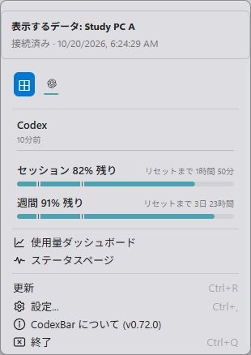

# Win-CodexBar + Mobile Connect v0.72.0

Windows同士・WindowsとMacで、取得済みの使用量・リセット時刻・保存済み履歴・費用／トークン集計を受信できます。設定の「モバイル接続」に「他のPCから受信」を追加しました。

- 接続名とコードを保存し、表示するPCを選択。「このPC」でローカル表示へ戻れます。
- LANまたは同じTailscaleネットワークで接続。exit nodeは不要です。
- スマホ・タブレット・別のPCから同時利用できます。
- 送信と受信は独立しています。互いに表示しても、受信データを再送して循環しません。
- 履歴・費用は送信元PCの集計期間とタイムゾーンを表示。受信できない詳細は別アカウントで補完しません。
- 切替後の古い応答を破棄し、オフライン中は最後の値と接続状態を表示します。
- Gemini専用ブラウザの切断と取得を直列化し、失効した接続のウィンドウ再作成を防止します。
- 上流の設定ファイル保護・Unixビルド修正を取り込みました。既存のWindows設定・Gemini接続・Androidプロトコルを維持します。

[Mac版](https://github.com/lingmulongtai/CodexBar-Mac-Mobile-Connect)は別リポジトリで管理します。[共通Project](https://github.com/users/lingmulongtai/projects/3)にAndroid・Windows・Macをまとめています。

## 接続

送信元で「モバイル接続 → このPCの使用量を共有」を有効にしてコードをコピーします。受信側の「他のPCから受信」に貼り付けて保存・接続してください。コードは閲覧権限を持つため、公開しないでください。

## 検証

Windowsで全Rustテスト（コア4,872件／CLI 1件／デスクトップ788件）、全フロントエンド1,357件が成功しました。その後の説明文・余白の調整は関連65件と再ビルドで確認しています。全ターゲットClippy、型チェック、フロントエンドビルドも成功しました。

新しくビルドしたWindowsアプリの2インスタンスを独立したデモ設定で起動し、UIからのコード登録、双方向受信、受信データを再送しないこと、ローカル設定の保持、送信元停止時の最後の値・オフライン表示、ローカルへのUI切替、アプリ差し替え・再起動後の接続復元を確認しました。ダッシュボードの表示元名と受信使用量も実画面で確認しています。これは1台のWindows PC上でのネイティブ検証で、複数実機間のTailscale経路を確認したものではありません。

MacのネイティブCIは別リポジトリで実行中です。Mac実機間のTailscale接続とGoogleログインは、利用できる実機がないため未実施です。

Windows EXEは署名なしです。既存のWebView2 Runtimeを利用し、更新時はアプリを終了してEXEを置き換えます。設定フォルダを削除しなければ既存の接続設定を引き継ぎます。
